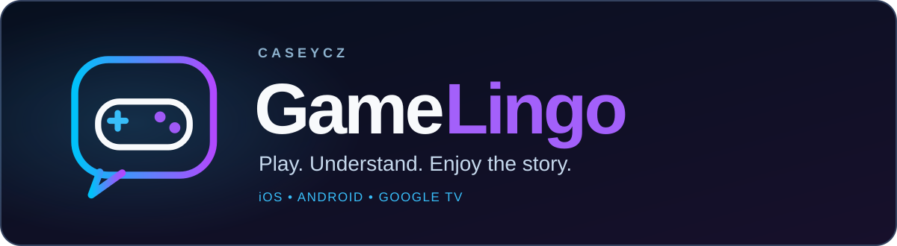

  

<h1 align="center">GameLingo</h1>

<strong>Hraj. Rozuměj. Užij si celý příběh.</strong>

Překládej herní titulky a texty v reálném čase přímo na telefonu nebo kompatibilní televizi. Bez zásahu do hry.

  <a href="#english">🇬🇧 English</a> · <a href="https://caseycz.github.io/">CaseyCZ Website</a> · <a href="https://github.com/CaseyCZ/GameLingo/issues">Zpětná vazba / Feedback</a>

  
  

  
  
  

---

## 🎮 Hraj bez jazykové bariéry

GameLingo rozpoznává text přímo z obrazu (OCR), překládá ho a zobrazuje překlad během hraní. Vyber si jazyk, nastav oblast titulků a soustřeď se na příběh.

- **Živý překlad:** dialogy, titulky a herní texty do češtiny, slovenštiny a dalších jazyků.
- **Standardní a automatický režim:** nastavitelné oblasti rozpoznávání textu.
- **Vlastní vzhled:** velikost, barva, pozadí a pozice titulků.
- **Herní profily a slovníky:** nastavení a vlastní překladové výrazy pro jednotlivé hry.
- **Telefon nebo TV:** výstup titulků na mobilu nebo spárované kompatibilní televizi.
- **Tři jazyky rozhraní:** čeština, slovenština a angličtina.

## 🕹️ Podporované platformy

| Platforma | Jak funguje |
| :--- | :--- |
| **Xbox Series X/S a Xbox One** | Remote Play přes telefon |
| **PlayStation 4 / 5** | Experimentální Remote Play; ověření na konzoli zatím čeká |
| **iPhone a Android** | Mobilní aplikace pro rozpoznávání a překlad herního textu |
| **Google TV / Android TV** | Příjem titulků z telefonu nebo přímé OCR podporovaného obrazu |

## 📲 Stažení

**[Stáhnout aktuální GameLingo z GitHub Releases](https://github.com/CaseyCZ/GameLingo/releases)**

| Zařízení | Instalační soubor |
| :--- | :--- |
| iPhone | `GameLingo-iOS-…-unsigned.ipa` — vyžaduje vlastní podpis |
| Android | `GameLingo-Android-…-TEST.apk` |
| Google TV / Android TV | `GameLingo-GoogleTV-…-TEST.apk` |

Vyber příslušný soubor v sekci **Assets** aktuálního vydání. Vydání jsou zatím testovací (TEST), nikoli potvrzená stabilní verze.

## ⚡ Jak začít

1. Nainstaluj aplikaci a vyber konzoli nebo režim TV.
2. Nastav jazyk hry, cílový jazyk překladu a oblast OCR.
3. Vyber výstup na telefonu nebo TV. Pro přenos na TV spáruj obě zařízení ve stejné důvěryhodné domácí síti.
4. Spusť překlad a hraj.

Kompatibilita závisí na zařízení a zdroji obrazu. Chráněný obsah může být pro OCR nedostupný. GameLingo překládá text, nikoli zvuk nebo mikrofon.

## 🔒 Soukromí a licence

OCR probíhá na zařízení. Online překladače mohou přijímat rozpoznaný text; místní cache lze vypnout a vymazat. Obsah titulků při spárovaném přenosu je šifrovaný (AES-GCM); aktualizuj telefon i TV. Volitelný starší režim přijímače šifrování nepoužívá. TV neobsahuje offline překladový model. Nepoužívej GameLingo pro citlivý text.

[Zásady ochrany osobních údajů](PRIVACY.md).

GameLingo je nezávislý open-source projekt navazující na PlayCaption, vydaný pod [GNU AGPL-3.0](LICENSE). Není oficiální aplikací Microsoftu, Sony ani Googlu. [Původ projektu](ATTRIBUTION.md) · [Licence třetích stran](THIRD_PARTY_NOTICES.md).

---

## 🇬🇧 English

**Play. Understand. Enjoy the story.**

GameLingo translates on-screen game subtitles and text in real time using OCR. Read translations on your phone or a compatible TV without modifying the game.

- Live translation of dialogue and game text into Czech, Slovak and other supported languages.
- Standard and automatic OCR modes with configurable recognition regions.
- Custom subtitle appearance and placement, game profiles and personal glossaries.
- Phone and compatible TV output; Czech, Slovak and English interface.

| Platform | Availability |
| :--- | :--- |
| Xbox Series X/S and Xbox One | Remote Play through a phone |
| PlayStation 4 / 5 | Experimental Remote Play; console validation pending |
| iPhone and Android | Mobile translation apps |
| Google TV / Android TV | Phone subtitle receiver and direct OCR of supported content |

**[Download GameLingo](https://github.com/CaseyCZ/GameLingo/releases)** — choose the iOS IPA (requires signing), Android APK or Google TV APK from the release assets. Current releases are test builds, not confirmed stable releases.

Install the app, choose a console or TV mode, select the source and target languages and OCR region, then start translation. For TV output, pair your phone and TV on the same trusted local network.

Compatibility depends on the device and video source. Protected content may not be available to OCR. GameLingo does not translate audio or microphone input.

**Privacy:** OCR runs locally; online translation may send recognized text to external providers. The local cache can be disabled and cleared. Paired TV subtitle payloads are encrypted (AES-GCM); update both phone and TV. The optional legacy receiver mode is not encrypted. The TV app has no offline translation model. Do not use GameLingo for sensitive text.

**[Privacy policy](PRIVACY.md)**

**Open source:** [AGPL-3.0](LICENSE) · [Attribution](ATTRIBUTION.md) · [Third-party notices](THIRD_PARTY_NOTICES.md). Based on PlayCaption, independently developed and not affiliated with Microsoft, Sony or Google.

---

## ❤️ Podpora / Support

Pokud ti GameLingo pomáhá, můžeš podpořit jeho další vývoj. If GameLingo helps you, consider supporting its development.

  

  

  <a href="https://caseycz.github.io/">CaseyCZ Website</a> · <a href="https://github.com/CaseyCZ/GameLingo/issues">Nápady a chyby / Feedback</a>

<strong>GameLingo — Enjoy the story, not the language barrier.</strong>

